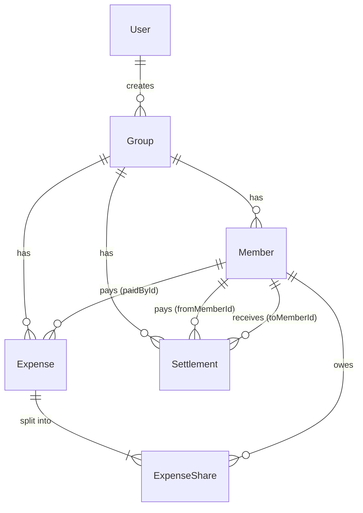

# Database

PostgreSQL 16, managed with Prisma ORM.

| What | Where |
| --- | --- |
| Prisma schema (source of truth) | [`backend/prisma/schema.prisma`](../backend/prisma/schema.prisma) |
| Migrations | [`backend/prisma/migrations/`](../backend/prisma/migrations/) |
| Generated SQL, for reference only | [`schema.sql`](schema.sql) |
| Seed data | [`seed/seed-data.json`](seed/seed-data.json), loaded by [`backend/prisma/seed.ts`](../backend/prisma/seed.ts) |

Don't edit `schema.sql` by hand. To change the schema, edit `schema.prisma`, run `npm run prisma:migrate` in `backend/`, then regenerate the reference file:

```bash
cd backend
npx prisma migrate diff --from-empty --to-schema-datamodel prisma/schema.prisma --script > ../database/schema.sql
```

## Entity relationships



## Tables

### User
An account that can sign in.

| Column | Type | Notes |
| --- | --- | --- |
| id | text (cuid) | PK |
| name | varchar(100) | |
| email | varchar(255) | unique, stored lower-case |
| passwordHash | text | bcrypt |
| createdAt | timestamp | |

### Group
| Column | Type | Notes |
| --- | --- | --- |
| id | text (cuid) | PK |
| name | varchar(100) | |
| createdAt | timestamp | |
| createdById | text, nullable | FK → User, `SET NULL` on delete |

### Member
A person in a group, identified by name and email. They don't need an account.

| Column | Type | Notes |
| --- | --- | --- |
| id | text (cuid) | PK |
| name | varchar(100) | |
| email | varchar(255) | unique per group: `@@unique([groupId, email])` |
| groupId | text | FK → Group, `CASCADE` |
| createdAt | timestamp | sets member display order |

### Expense
| Column | Type | Notes |
| --- | --- | --- |
| id | text (cuid) | PK |
| description | varchar(200) | |
| amount | **numeric(12,2)** | always > 0 |
| date | date | calendar date, no time |
| splitType | enum `EQUAL \| EXACT \| PERCENTAGE` | default `EQUAL` |
| category | enum `FOOD \| TRAVEL \| ACCOMMODATION \| ENTERTAINMENT \| SHOPPING \| UTILITIES \| OTHER` | default `OTHER` |
| groupId | text | FK → Group, `CASCADE` |
| paidById | text | FK → Member, `RESTRICT` |
| createdAt | timestamp | |

### ExpenseShare
How much one member owes for one expense.

| Column | Type | Notes |
| --- | --- | --- |
| id | text (cuid) | PK |
| expenseId | text | FK → Expense, `CASCADE` |
| memberId | text | FK → Member, `RESTRICT` |
| shareAmount | **numeric(12,2)** | |

`@@unique([expenseId, memberId])`: a member appears at most once per expense.

### Settlement
A payment from one member to another.

| Column | Type | Notes |
| --- | --- | --- |
| id | text (cuid) | PK |
| fromMemberId | text | FK → Member (payer), `RESTRICT` |
| toMemberId | text | FK → Member (receiver), `RESTRICT` |
| amount | **numeric(12,2)** | always > 0 |
| date | timestamp | defaults to now |
| note | varchar(200), nullable | e.g. "UPI transfer" |
| groupId | text | FK → Group, `CASCADE` |
| createdAt | timestamp | |

## Money rules

* Every money column is `numeric(12,2)` (Prisma `Decimal`). None are `Float`.
* The API converts amounts to integer **paise** by parsing the string, not with floating-point maths. It does all arithmetic in paise and converts back to a 2-decimal string only when writing to the database or returning a response.
* **Equal split:** each member gets `floor(total / n)`. The leftover paise go one each to the last members, so Rs 1,000 split three ways is 333.33, 333.33, 333.34.
* **Exact split:** the shares must add up to the expense amount exactly.
* **Percentage split:** percentages are stored as basis points and must total 100%. Leftover paise go to the largest fractional remainders.
* Shares always add up to the expense amount, so **the sum of all net balances in a group is exactly 0**.
* An expense and its shares are written in **one Prisma transaction** (`persistExpense` in `backend/src/services/expense.service.ts`). If either insert fails, neither is saved.

## Net balance

```
net = paid for expenses − own shares + settlements paid − settlements received
```

A positive net means the member gets money back; a negative net means they owe. The API recomputes balances from the ledger on every request, so a new settlement shows up immediately.

## Seed data

`npm run db:seed` (in `backend/`) **deletes all existing data**, then loads the seed:

* 4 users (`aarav@`, `priya@`, `rohan@` and `sneha@example.com`), all with the password `password123`.
* Kabir Singh (`kabir@example.com`), a member of "Goa Trip 2026" who has no account.
* "Goa Trip 2026": 5 members, 5 expenses using all three split types and several categories, and 1 settlement.
* "Team Lunch - October": Rs 1,000 split three ways, which demonstrates the 333.33 / 333.33 / 333.34 rule.
